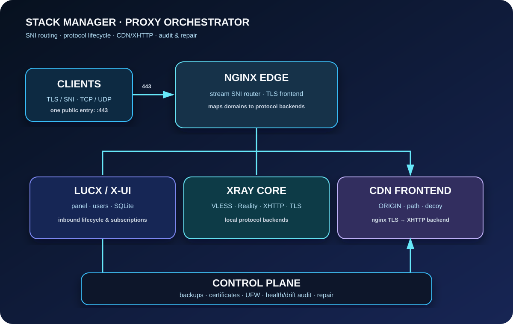

<p align="center">
  
</p>

<h1 align="center">Stack Manager</h1>

<p align="center">
  <strong>One server. One port 443. Full routing control.</strong><br/>
  <sub>SNI orchestrator for LucX/x-ui, Xray and nginx — install, configure, audit, maintain and roll back, all in a single Bash file</sub>
</p>

<p align="center">
  <a href="README.md">Русский</a> · <b>English</b>
</p>

<p align="center">
  <a href="https://github.com/vladufqaa/stack-manager/releases/latest"></a>
  <a href="https://github.com/vladufqaa/stack-manager/actions/workflows/ci.yml"></a>
  
  
  
  
</p>

<p align="center">
  <a href="#-what-is-it">What is it</a> ·
  <a href="#-how-it-works">How it works</a> ·
  <a href="#-features">Features</a> ·
  <a href="#-quick-start">Install</a> ·
  <a href="#-menu">Menu</a> ·
  <a href="#-diagnostics">Diagnostics</a> ·
  <a href="#-file-layout">Files</a>
</p>

---

## 🧭 What is it

**Stack Manager** is a control layer on top of the LucX/x-ui panel, Xray and nginx. It does not replace the panel — it keeps the related configurations consistent: the SQLite database, the nginx SNI map, CDN profiles, decoy pages, certificates and the firewall.

> [!TIP]
> Core principle: **verify first, change second**. The read-only audit touches nothing and shows every drift; any repair happens only after an explicit choice in the menu.

> [!NOTE]
> The interactive TUI is in Russian. Below, every section and menu tree is described in English so you can navigate it with confidence.

## 🏗 How it works

<p align="center">
  
</p>

- All TCP services are multiplexed through a single external port **443** by SNI.
- Only the necessary ports are exposed; UDP protocols run directly and are checked separately.
- Stack Manager manages not just inbound connections but every related artifact: SQLite, nginx, the SNI map, CDN profiles, certificates and decoys.

## ✨ Features

| | |
|---|---|
| 🎯 **SNI multiplexing** | TCP services behind a single external `443` via nginx stream |
| 🛰 **VLESS Reality & TLS** | External target or your own SNI + HTTPS decoy |
| 🌐 **XHTTP via CDN** | CDN domain, ORIGIN, path, hosts and the nginx frontend — one wizard keeps them consistent |
| 🧩 **AmneziaWG 3.1 / 2.0** | UDP panel-sidecar inbounds with obfuscation (Premium profile), audit and UFW repair |
| 🎭 **Decoy templates** | Camouflage for domains, Reality and TLS routes + your own `index.html` |
| 🔒 **Certificates** | Let's Encrypt, Cloudflare DNS-01 wildcard, custom certs, A/B cert lines, audit and renewal |
| 🩺 **Audit & self-repair** | Full read-only health/drift audit + "⚡ Check everything and fix" with a before → after delta |
| 🧭 **Xray DNS** | System DNS, Cloudflare/Google/Quad9 DoH, self-hosted, custom — verified with a real DoH query before applying |
| 🛡 **Security** | UFW, fail2ban, backups, diagnostics, full rollback with journaling |

## 🚀 Quick start

**Requirements:** Ubuntu 22.04+ / Debian 11+, root, a domain with DNS pointing to the server, SSH and 443 open; for wildcard certificates — a Cloudflare API Token with `Zone:DNS:Edit` permission.

```bash
curl -4 -fsSL \
  "https://raw.githubusercontent.com/vladufqaa/stack-manager/main/stack-manager.sh?ts=$(date +%s%N)-$$" \
  -o /root/stack-manager.sh
sed -i 's/\r$//' /root/stack-manager.sh
chmod 700 /root/stack-manager.sh
bash -n /root/stack-manager.sh
bash /root/stack-manager.sh
```

Or as a one-liner:

```bash
curl -4 -fsSL "https://raw.githubusercontent.com/vladufqaa/stack-manager/main/stack-manager.sh?ts=$(date +%s%N)-$$" \
  | tr -d '\r' > /root/stack-manager.sh && chmod 700 /root/stack-manager.sh && \
  bash -n /root/stack-manager.sh && bash /root/stack-manager.sh
```

> [!IMPORTANT]
> GitHub/raw proxies sometimes serve the file with Windows `CRLF` line endings. The `sed -i 's/\r$//'` step is mandatory, otherwise Bash fails with `invalid option name` and `syntax error near $'{\r'`. Verify with `file /root/stack-manager.sh` — the output must not contain `CRLF line terminators`.

> [!NOTE]
> Menu item 1 runs in two stages: it first collects parameters and shows the plan; changes are applied only after confirmation.

## 📟 Menu

```text
 1) 🧭 Установка и маршрутизация   — Installation & routing
 2) 🎭 Decoy и домены              — Decoy & domains
 3) 🔒 Сертификаты                 — Certificates
 4) 🛡️ Безопасность и firewall     — Security & firewall
 5) 💾 Бэкапы и откат              — Backups & rollback
 6) 🩺 Диагностика и обслуживание  — Diagnostics & maintenance
 7) ⚙️ Панель и AdGuard            — Panel & AdGuard
 0) Выход                          — Exit
```

<details>
<summary><b>Full submenu tree</b></summary>

```text
1) Installation & routing
├─ 1) Первичная настройка SNI-роутера        — Initial SNI router setup
└─ 2) Инбаунды: проверка, добавление…        — Inbounds: check, add, remove, domains

2) Decoy & domains
├─ 1) Сменить decoy                          — Change decoy
├─ 2) Каталог decoy-шаблонов                 — Decoy template catalog
└─ 3) Сменить домен inbound                  — Change inbound domain

3) Certificates
└─ Let's Encrypt · wildcard DNS-01 · custom certs · A/B lines · audit · renewal

4) Security & firewall
├─ 1) Баны, decoy-login, fail2ban            — Bans, decoy-login, fail2ban
├─ 2) Правила firewall                       — Firewall rules
└─ 3) Восстановить состояние firewall        — Restore firewall state

5) Backups & rollback
├─ 1) Сделать бэкап                          — Create backup
├─ 2) Восстановить из бэкапа                 — Restore from backup
├─ 3) Откат и демонтаж стека                 — Rollback & stack teardown
└─ 4) Pre-install snapshot                   — Snapshot taken before changes

6) Diagnostics & maintenance
├─ 1) ⚡ Проверить всё и починить            — ⚡ Check everything and fix (audit → repair → verify)
├─ 2) Статус стека                           — Stack status
├─ 3) Маршрутизация и диагностика            — Routing & diagnostics
├─ 4) Полный read-only аудит стека           — Full read-only stack audit (incl. CDN & drift)
├─ 5) Сменить пароли LucX UI / AdGuard Home  — Change LucX UI / AdGuard Home passwords
└─ 6) Обновить скрипт                        — Update the script

7) Panel & AdGuard
├─ 1) Управление LucX/3x-ui                  — Manage LucX/3x-ui
├─ 2) Управление AdGuard Home                — Manage AdGuard Home
└─ 3) DNS Xray в панели LucX/3x-ui           — Xray DNS in the LucX/3x-ui panel
```

Left column is the actual on-screen text (Russian); right column is the English meaning.

</details>

### ⚡ Check everything and fix

A single pass from section 6: **read-only audit → safe auto-repair of what was found → verification** with a before → after delta. It fixes deterministic issues: restarts fallen nginx/x-ui, syncs inbound certs/decoys, repairs CDN drift, opens missing UFW rules for UDP inbounds, rebuilds the xray config for dead sockets. It never spends Let's Encrypt rate limits and never blindly edits a broken nginx config — it shows the reason instead. Explicit confirmation is required before any repair.

## 📡 Supported inbounds

| # | Inbound | Transport | Notes |
|---|---|---|---|
| 1 | VLESS TCP REALITY | TCP behind 443 | `xtls-rprx-vision`, external target or own SNI |
| 2 | VLESS TCP TLS | TCP behind 443 | with HTTPS decoy |
| 3 | VLESS XHTTP (via CDN) | TCP behind 443 | TLS terminated by nginx, full CDN profile |
| 4 | VLESS XHTTP REALITY | TCP behind 443 | |
| 5 | NAIVE | TCP behind 443 | panel sidecar |
| 6 | TRUSTTUNNEL | TCP behind 443 | panel sidecar |
| 7 | ANYTLS | TCP behind 443 | panel sidecar |
| 8 | HYSTERIA2 | UDP | direct + UFW rule |
| 9 | QWDTT | UDP 56000 | direct + UFW rule |
| 10 | CSQTT | UDP 46000 | direct + UFW rule |
| 11 | AMNEZIAWG 3.1 | UDP | LucX sidecar, Premium profile, obfuscation |
| 12 | AMNEZIAWG 2.0 | UDP | LucX sidecar, Premium profile, obfuscation |
| 13 | TG WEB-PROXY | 443 → 11443 | proxies a live target, no decoy needed |

TCP inbounds are routed by nginx via SNI; UDP inbounds run directly and are checked separately against the firewall. All TCP inbounds (except CDN) share a single "one host" subscription group: the default group name is "443", editable in the panel; a CDN inbound gets its own hosts entry.

## 🛰 Reality: two modes

**1) Find an external target** — a candidate domain is checked for TLS 1.3 and HTTP/2, then used as `serverNames`/`dest`; no certificate is issued and no local decoy is created.

**2) Specify your own SNI domain** — your own subdomain, certificate issue/selection, an HTTPS decoy and an entry in the nginx SNI map. The certificate and decoy can be changed later via section 2.

## 🌐 VLESS XHTTP via CDN

The CDN mode is for **VLESS XHTTP without TLS inside Xray**: nginx terminates TLS.

```text
client → CDN domain:443 → CDN → ORIGIN domain:443
       → nginx SNI → local TLS frontend → Xray XHTTP (127.0.0.1:<port>)
```

The wizard creates a single CDN profile and keeps everything consistent: the CDN domain, the ORIGIN domain, the XHTTP path, origin SNI/Host, the nginx SNI route and an HTTPS decoy for ORIGIN on all other paths. A certificate is needed **only for ORIGIN** — on the public side TLS is terminated by the CDN itself. The CDN provider (Beget / Yandex Cloud / other) is chosen in the wizard and stored in the profile.

<details>
<summary><b>CDN scheme details: what must match, certificates, diagnostics</b></summary>

**What must match for a working connection:**

```text
client:       address = CDN domain, port = 443
XHTTP:        host = ORIGIN domain, path = /your/path
panel hosts:  address/sni/host_header = CDN domain, security = tls
nginx:        ORIGIN and CDN domain → XHTTP path → local Xray port
```

**Rules:**

- ORIGIN must resolve to the server **before** the certificate is issued;
- the CDN domain is never added to the SAN of a Stack Manager certificate and is never used as the origin certificate name;
- the Xray inbound is plain XHTTP without `security=tls`/`reality` and without `externalProxy` (otherwise traffic bypasses the nginx route);
- profiles are stored in `/root/stack-backups/cdn-profiles.tsv`; deleting an inbound removes its profile, hosts entry and nginx artifacts as stale.

**Verification:** `6) Diagnostics → 4) Full read-only stack audit` checks the panel database, XHTTP host/path, `hosts`, the SNI map, the nginx block, the decoy, the ORIGIN certificate and the real responses of the local frontend. `⚡ Check everything and fix` restores the route, `location ^~ <path>/`, the hosts entry and the profile settings.

**Quick manual checks:**

```bash
nginx -t
sed -n '1,220p' /etc/nginx/streams-enabled/sni-router.conf
grep -n -A45 -B2 '# >>> cdn' /etc/nginx/sites-enabled/stack.conf
cat /root/stack-backups/cdn-profiles.tsv
```

If the client receives HTML decoy content or an `unknown version: 60` error, a session request hit the decoy instead of Xray: check `location ^~ <path>/` and that the client `path` exactly matches the profile and `xhttpSettings.path`.

</details>

## 🎭 Decoy

Decoy templates + a custom `index.html`. A decoy is applied only where it does not break the protocol: your own Reality, the panel, the TCP HTTPS part of Hysteria/Hysteria2, individual TCP routes. **Never assigned to:** external Reality, AnyTLS, naive/trust-tunnel (TLS terminated by the sidecar), TG WEB-PROXY, UDP transports without a separate TCP entry. If the panel domain root is occupied by AdGuard Home, changing the root decoy is blocked — to protect the UI and DoH.

## 🧭 Xray DNS and DoH

Location: `7) Панель и AdGuard → 3) DNS Xray`. Supported: system DNS, Cloudflare/Google/Quad9 DoH, the panel's self-hosted DoH and a custom endpoint.

> [!WARNING]
> Profiles 5 and 6 are **always verified**: before touching the panel the script performs a real DNS-over-HTTPS query (HTTP 200, `RCODE=0`, an actual answer, valid IPv4/hostname, host matching the URL). If the endpoint is unreachable, Xray is not modified and the panel is not even stopped.

<details>
<summary><b>How DNS settings are applied</b></summary>

Settings are applied to the panel's global Xray template:

```text
/etc/x-ui/x-ui.db
└── settings
    └── xrayTemplateConfig
```

If `xrayTemplateConfig` does not exist, Stack Manager safely creates it from the current working `/usr/local/x-ui/bin/config.json` — and only after verifying the mandatory `direct`/`blocked` outbounds and existing `routing.rules`. A backup is taken before the change; on a write error, a failed panel restart or DNS loss the configuration is rolled back. A minimal/incomplete Xray config is never created.

**Verify the result:**

```bash
sqlite3 -noheader /etc/x-ui/x-ui.db \
  "SELECT value FROM settings WHERE key='xrayTemplateConfig';" | \
  jq '{dns: .dns, domainStrategy: .routing.domainStrategy}'

jq '{dns: .dns, domainStrategy: .routing.domainStrategy}' \
  /usr/local/x-ui/bin/config.json
```

</details>

## 🩺 Diagnostics

Section `6) Диагностика и обслуживание` (Diagnostics & maintenance):

```text
1) ⚡ Проверить всё и починить   — audit → auto-repair → verify
2) Статус стека                  — stack status
3) Маршрутизация и диагностика   — routing & diagnostics
4) Полный read-only аудит стека  — full read-only stack audit (incl. CDN & drift)
5) Сменить пароли                — change LucX UI / AdGuard Home passwords
6) Обновить скрипт               — update the script
```

The full audit checks inbounds, hosts, SNI/nginx, CDN, decoys, certificates, systemd units and real listening sockets — and **repairs nothing**.

Without the menu:

```bash
bash /root/stack-manager.sh --check        # read-only full audit
bash /root/stack-manager.sh --self-test    # same
```

Verify a byte-identical copy against GitHub:

```bash
curl -4 -fsSL \
  "https://raw.githubusercontent.com/vladufqaa/stack-manager/main/stack-manager.sh?ts=$(date +%s)" \
  -o /tmp/stack-manager.remote.sh
cmp -s /root/stack-manager.sh /tmp/stack-manager.remote.sh && echo 'Files match'
```

## 💾 Backups and rollback

Before changes the script creates automatic backups and a pre-install snapshot. A full rollback restores `x-ui.db` entirely to the pre-install snapshot: Reality, CDN/XHTTP, hosts, SNI fields, panel settings and clients return to the moment of the snapshot.

> [!WARNING]
> A full rollback discards changes made **after** the snapshot: new inbounds, clients and panel settings. An emergency copy of the current `x-ui.db` is created before the database is replaced.

Never removed automatically: AdGuard Home and Let's Encrypt certificates in `/etc/letsencrypt/live/`. If a pre-install snapshot is missing, a partial restore of available settings is used.

**Data safety:** user certificates and `/root/cert` are not removed during normal maintenance; inbounds and clients are not replaced by a partial rollback; automatic changes are logged to `/root/stack-actions.log`; SQL edits stop the panel when required; the SNI map is validated before new routes are added; `q` at any prompt returns to the menu.

## 📍 File layout

| Path | Purpose |
|---|---|
| `/root/stack-manager.sh` | The main script |
| `/etc/x-ui/x-ui.db` | LucX/x-ui database |
| `/etc/nginx/streams-enabled/sni-router.conf` | SNI map and stream routing |
| `/etc/nginx/sites-enabled/stack.conf` | Panel & decoy HTTP/HTTPS configuration |
| `/var/www/decoy-templates/` | Decoy templates |
| `/root/stack-backups/` | Automatic backups, pre-install snapshots, CDN profiles |
| `/root/stack-actions.log` | Action journal |

<details>
<summary><b>🛟 Troubleshooting</b></summary>

### `Too many levels of symbolic links`

```bash
rm -f /etc/nginx/streams-enabled/sni-router.conf
rm -f /etc/nginx/streams-available/sni-router.conf
nginx -t
```

The script will recreate the SNI config as a regular file.

### `invalid number of the map parameters`

Lines inside `map` must contain exactly two values and a `;`:

```nginx
domain.example.com    inb_4_backend;
```

```bash
sed -n '1,160p' /etc/nginx/streams-enabled/sni-router.conf
```

The updated script cleans broken lines before adding a new route.

### ORIGIN fails the DNS check

Point the ORIGIN domain's A/AAAA record to the server IP and wait for DNS to update:

```bash
getent ahosts origin.example.com
```

Then retry the certificate issuance in section 3.

</details>

## 🧱 Development

- The source of truth is the modules in `src/NNN-name.sh`; the numeric prefix defines the build order.
- `./build.sh` concatenates the modules into `stack-manager.sh`; the result must match the committed file byte-for-byte — CI enforces the same check.
- Edit `src/`, run `./build.sh`, and commit both sides (modules and the assembled file).
- CI on every push/PR: `bash -n`, ShellCheck (pinned 0.11.0, exceptions in `.shellcheckrc`) and a build-sync check.
- Releases: the `v<version>` tag → a workflow builds the `tar.gz` and publishes a release with notes from [CHANGELOG.md](CHANGELOG.md).
- `stack-manager-update.sh` is a separate self-update helper.

## 🙏 Acknowledgements

The project uses and integrates: [LucX UI](https://github.com/AlexeyLCP/lucx-ui) · [3x-ui](https://github.com/MHSanaei/3x-ui) · [AdGuard Home](https://github.com/AdguardTeam/AdGuardHome) · [nginx](https://nginx.org/) · [Certbot](https://certbot.eff.org/) · [fail2ban](https://github.com/fail2ban/fail2ban) · [UFW](https://launchpad.net/ufw)

Special thanks to [Mannokia](https://github.com/Mannokia) for ideas and contributions: A/B certificate lines, wildcard issuance via Cloudflare DNS-01, certificate auditing, duplicate cleanup and TUI firewall management.

## 📄 License

MIT. Use the software in accordance with the law of your jurisdiction.
