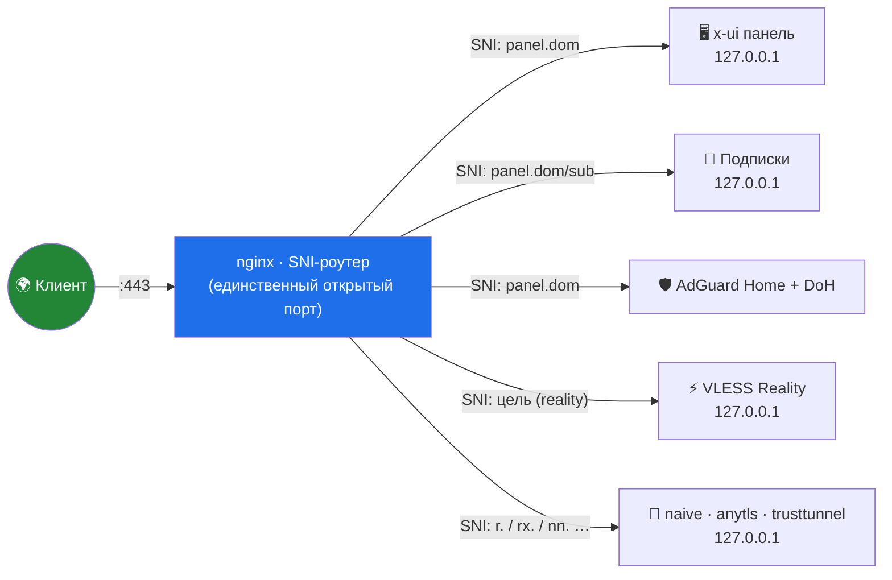

<div align="center">

# 🛰️ stack-manager

### SNI-стек «всё за 443» в одном файле

**LucX / x-ui · AdGuard Home · nginx SNI-роутер · Reality · decoy · fail2ban · UFW · Let's Encrypt**


*Один bash-скрипт поднимает и обслуживает весь прокси-стек: от установки до починки.*
*Наружу смотрит единственный порт — 443. Всё остальное слушает 127.0.0.1.*

</div>

---

## ✨ Возможности

| | |
|:---|:---|
| 🔐 **«Всё за 443»** | Панель, подписки, DoH и все TCP-инбаунды живут за одним nginx-роутером по SNI. Наружу — только 443 и SSH. |
| 🎭 **Reality × 2** | **Чужой реалити** — маскировка под cloudflare/microsoft/sony/… (серт не нужен). **Свой SNI** — личный поддомен + LE-серт + decoy. |
| 🎯 **«Найти цели»** | Живая проверка кандидатов (TLS 1.3 + ALPN h2) и выбор цели списком — как кнопка в панели. |
| 🖥️ **Быстрое главное меню** | Шапка показывает название стека и быстрый статус nginx, x-ui, AdGuard, fail2ban, UFW и количество активных inbounds. Тяжёлые проверки не выполняются при каждом возврате в меню; полный аудит запускается отдельно в разделе 6 или через `--check` / `--self-test`. |
| 🛡️ **AdGuard Home** | 3 режима: за корнем панели · отдельный SNI-домен · локально. DoH через 443, нативный TLS в yaml. Установка/удаление — единым пунктом по состоянию. |
| 🃏 **Decoy-заглушки 2.0** | 19 шаблонов + **custom** (свой index.html): статика и реплики логинов 1:1. Штатная схема — decoy только для **Reality-инбаундов и панели**; для naive/anytls/trusttunnel/TG WEB-PROXY decoy не назначается. Если корень панели проксирует AdGuard Home, смена decoy панели запрещена, чтобы не сломать UI и DoH. Режимы: **redirect 302** и **locked 401**. |
| 🤖 **Анти-бот** | UA-свитч: сканерам (curl/python/nmap/…) — пустая 404, живому браузеру — сайт. Honeypot-ссылки (`/admin`, `/.env`, `/wp-login.php`) — касание = мгновенный бан. robots.txt в комплекте. |
| 📜 **Серты на автопилоте** | certbot + deploy-hook + таймер самолечения каждые 2 минуты. Серты только в `live/`. Email LE сохраняется и переживает перезапуски. Резолвер сам выбирает серт: **точный → wildcard → SAN**. При п.1 явно выбирается тип выпуска: **wildcard Cloudflare DNS-01** или персональные HTTP-01; wildcard считается активным только при наличии реального `fullchain.pem` с `*.<домен>` в SAN. **Линии A/B (п.10.14)**: A — одна SAN-линия на всё; B — линия на базовый домен (рекомендуется). Выпуск умный: DNS-фильтр до certbot, идемпотентность, сохранение wildcard при мульти-SAN-перевыпуске, аудит сертов, удаление сирот, чистка дублей `-0001`, синк серта панели/подписок. |
| 🚫 **fail2ban + UFW** | Баны по login-декоям и honeypot-путям, jail **recidive** для рецидивистов. Быстрый экран меню показывает только состояние UFW; подробные баны по всем jail'ам доступны в диагностике. Файрвол с выбором политики (внутри раздела 4): **allowlist** — наружу только необходимое; **hide-only** — без reset, закрывается только спрятанное. |
| 🕶 **Стелс-аудит** | Раздел диагностики и обслуживания: взгляд на сервер глазами Shodan/Censys — открытые порты (TCP/UDP vs UFW), какой серт видит сканер на 443 без SNI, HTTP:80, SSH, open resolver, публичные имена из Certificate Transparency (crt.sh), подсказки по opt-out. Только чтение. |
| 🧽 **Гигиена nginx** | `server_tokens off` (идемпотентно, с размноженным дублем разбирается сам), security-заголовки на decoy-блоки через сниппет, logrotate для decoy-логов, если их не накрывает системный. |
| 🩹 **Самолечение** | hosts-починка, ре-привязка сертов, восстановление потерянных портов инбаундов и tg-маршрута, чистка мёртвых SNI-записей — само, без рук. Служебные инбаунды панели с портом 0 не трогает. **Заморозка**: `cert:<домен>` / `inbound:<id>` / `ALL-CERTS` — отмеченное автоматика обходит молча; управление находится в разделе диагностики и обслуживания. |
| 🛡 **Защита БД от перезаписи панелью** | SQL-триггеры в x-ui.db: панель при правке инбаунда может затереть вписанные скриптом пути сертов / reality-dest / hostname — триггер возвращает их на месте (легитимные правки и первичная запись проходят свободно). Снесённые hosts-строки возвращаются **мгновенно** (триггер на DELETE + дедуп от дублей), самолечение — страховка. Выключатель — внутри раздела диагностики и обслуживания. |
| 🧭 **Двухфазная настройка** | Раздел установки: сначала анкета (домен, email, креды, AdGuard, decoy, инбаунды, файрвол) → сводка **ПЛАН** → подтверждение → применение. Отмена на этапе плана = ничего не изменено. |
| 🫥 **Автодетект «голых» инбаундов** | Создал инбаунд руками в панели, а порт закрыт файрволом? Управление инбаундами увидит TCP-инбаунды вне 443 и предложит спрятать (SNI + серт + hosts по очереди). vless/trojan+TLS получают **fallback-заглушку** на nginx :80 — пробой браузером увидит сайт, а не reset. |
| 🚚 **Переезд домена панели** | Управление сертификатами: сертификат нового домена + webDomain/hosts в БД + nginx (SNI-карта, маркер decoy) + credentials одним проходом, с бэкапом и откатом; старый серт опционально отзывается. |
| ⏪ **Откат и снимки** | п.23 — пошаговый демонтаж стека с подтверждением каждого шага; п.24 — pre-install снимок «как было до скрипта» и восстановление из него. |
| 🩺 **Диагностика** | Раздел 6: статус стека, полный read-only аудит, наблюдение, SNI cleanup/rebuild, nginx-гигиена и стелс-аудит. Проверка без запуска меню: `bash stack-manager.sh --check` или `--self-test`. Live-таблица инбаундов находится в разделе управления инбаундами. |
| 📜 **Аудит действий** | Каждая операция, меняющая систему — строка в `/root/stack-actions.log` (дата · кто · что). |
| ⌨️ **Удобство** | `q` в любом вопросе → возврат в меню. Смена домена инбаунда без пересоздания. Порты: запрет 443/80 и проверка занятости. URL подписок без `:443`. Плейсхолдеры `*.example.com` в меню не проходят. |

## 🗺️ Как это устроено



## 🚀 Быстрый старт

```bash
# 1. залить на сервер
scp ./stack-manager.sh root@SERVER:/root/stack-manager.sh

# 2. запустить
ssh root@SERVER
bash /root/stack-manager.sh
```

> [!TIP]
> Нужны: Ubuntu 22.04+/Debian 11+, root, домен с A-записью на сервер, открыты **22** и **443**.
> Дальше — п.1, двухфазно: сначала анкета (**панель → email LE → тип сертификата → AdGuard → заглушка → инбаунды → файрвол**),
> затем сводка **ПЛАН** и только после подтверждения — применение. При выборе wildcard нужен Cloudflare API Token с правами `Zone:DNS:Edit` для зоны. Скрипт проверяет реальный сертификат и SAN `*.<зона>`, а не только флаг состояния.
>
> Повторный запуск п.1 на настроенном стеке вежливо спросит подтверждение. После отката/удаления nginx п.1 повторно проверяет зависимости и восстанавливает nginx перед сборкой SNI.

## 📋 Меню

<details>
<summary><b>Развернуть все 27 пунктов</b></summary>

| Пункт | Действие |
|:---:|---|
| **1** | Первичная настройка SNI-роутера — двухфазная: анкета (домен/email/**тип сертификатов**/креды/AdGuard/decoy/инбаунды/файрвол) → сводка ПЛАНА → подтверждение → применение; при wildcard — Cloudflare DNS-01 и проверка реального SAN |
| **2** | 🧪 Инбаунды: единое подменю проверки/live-таблицы, добавления, удаления inbound или только SNI-привязки и смены домена; внутри сохраняются прежние действия и подтверждения |
| **3** | Удалить inbound (список всех, включая UDP; SNI-домены как маркеры) |
| **4** | Decoy-заглушки: 19 шаблонов + custom + redirect/locked. Штатно decoy только у Reality и панели; 4.1 — раздать Reality-инбаундам, 4.2 — выбрать Reality-инбаунд, 4.3 — decoy панели (смена запрещена, если корень панели — AdGuard Home), 4.4 — вернуть исходную схему |
| **5** | Каталог decoy-шаблонов · пересборка всех блоков · «проверить как посторонний» (человек vs сканер) |
| **6** | Статус + доступы (URL панели / AdGuard / DoH, логины, пароли) |
| **7** | Безопасность: баны fail2ban, деко-логины, whitelist · статистика decoy-посещений за 24ч · «забанить всех, кто открывал decoy» · живой лог fail2ban |
| **8** | Бэкап конфигурации |
| **9** | Восстановить из бэкапа |
| **10** | Сертификаты: renew, dry-run, явный выпуск wildcard через Cloudflare DNS-01, выпуск через панель, обзор, **переезд домена панели**, **мультисерт** (пересборка/добавить/удалить домен), **аудит сертов**, **удаление по имени**, **линии A/B**, **очистка сирот и дублей -0001**, **аудит линий (SAN файла vs серт)** |
| **11** | Файрвол с выбором политики: **allowlist** (reset, только нужное) / **hide-only** (без reset, deny панельных+11443) + **свои порты** (постоянные исключения, п.11.9) + **TUI-обзор** правил × сокетов (п.11.10) |
| **12** | Восстановить состояние файрвола из снимка |
| **13** | Панель LucX UI: установить / удалить — единый пункт, сам видит, стоит ли |
| **14** | AdGuard Home: установить / удалить — аналогично |
| **15** | Очистка SNI от записей без инбаундов (tg-маршрут восстанавливается сам; доступно внутри раздела диагностики) |
| **16** | Сменить пароли admin (панель / AdGuard, с проверкой наличия) |
| **17** | Обновить сам скрипт (raw.githubusercontent с cache-buster) |
| **18** | Диагностика и обслуживание: статус, read-only аудит, наблюдение, SNI cleanup/rebuild, nginx-гигиена, стелс-аудит, обновление, пароли и заморозка самолечения |
| **19** | Инбаунды live: таблица (слушается/серт/клиенты/трафик) — доступно внутри раздела управления инбаундами; UDP по протоколу, port-hopping как `✓*` |
| **20** | Сменить домен инбаунда без пересоздания (БД + hosts + SNI-карта + серты + decoy; доступно внутри управления инбаундами) |
| **21** | Гигиена nginx: server_tokens off, security-заголовки decoy, ротация логов |
| **22** | Стелс-аудит: глазами Shodan/Censys — порты, серт 443 без SNI, HTTP:80, SSH, DNS, crt.sh, opt-out |
| **23** | Полный откат / демонтаж стека по шагам (сервисы, конфиги, порты, файрвол) — с подтверждением каждого шага |
| **24** | Pre-install снимок: сохранить состояние «до скрипта» / восстановить его |
| **25** | ❄ Заморозка самолечения: `cert:<домен>` / `inbound:<id>` / `ALL-CERTS` + **защита БД** вкл/выкл (SQL-триггеры: панель не затирает серты/dest/hostname) |
| **26** | 🔄 Пересобрать SNI из текущей БД без пересоздания инбаундов, БД или сертификатов; временный конфиг, проверка `nginx -t` и автоматический откат при ошибке |
| **27** | 🔍 Полный read-only аудит стека и режим `--check`/`--self-test` без запуска установки, бэкапов и самолечения |

### Главное меню

Главное меню объединено в семь разделов:

```text
1) Установка и маршрутизация
2) Decoy и домены
3) Сертификаты
4) Безопасность и firewall
5) Бэкапы и откат
6) Диагностика и обслуживание
7) Панель и AdGuard
0) Выход
```

Переходы по меню ускорены: тяжёлые проверки не запускаются при каждом возврате на главный экран. Полный аудит запускается из раздела 6 или командами `--check` / `--self-test`. Существующие операции находятся внутри соответствующих подменю, а их подтверждения и внутренняя логика сохранены.
| **0 / q** | Выход · `q` в любом вопросе — выход в меню |

</details>

## 🧠 Принципы

- **Один порт.** Наружу только 443: меньше сигнатур, меньше пробивов.
- **План прежде изменений.** п.1 сначала собирает анкету и показывает план — применение только после явного подтверждения.
- **Замороженное свято.** Что отмечено в п.25 — автомика (heal-таймер, авто-выпуск сертов) обходит молча; ручные пункты меню работают как обычно.
- **Тишина для сканера.** На чужой SNI — живая заглушка или прокси на настоящую цель, а не «connection refused».
- **Тихий старт.** Скрипт при каждом запуске проверяет состояние молча и пишет в консоль только то, что реально сделал: панель не дёргается, шаблоны не перетираются, логи не шумят.
- **Ничего лишнего в памяти.** Панель держит состояние in-memory — поэтому любая правка БД идёт по схеме *stop → edit → start*.
- **Действия — под учёт.** Каждая системная операция попадает в `/root/stack-actions.log`.
- **Секреты не в git.** Пароли генерируются на сервере: `/root/panel-credentials.txt`, `/root/adguard-credentials.txt` (0600).

## 📦 Установка на сервер одной строкой

```bash
curl -fsSL https://raw.githubusercontent.com/vladufqaa/stack-manager/main/stack-manager.sh -o /root/stack-manager.sh && bash /root/stack-manager.sh
```

## 🙏 Благодарности

- [**Mannokia**](https://github.com/Mannokia) — автор форка, из которого мы берём фичи: линии сертификатов A/B, умный выпуск с DNS-фильтром и идемпотентностью, аудит сертов и линий, чистка сирот и дублей `-0001`, синк серта панели/подписок, TUI-обзор файрвола.

---

<div align="center">

**MIT** · сделано для личного сервера · используйте в соответствии с законами вашей юрисдикции

⭐ — если пригодилось

</div>
