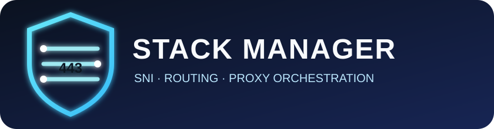
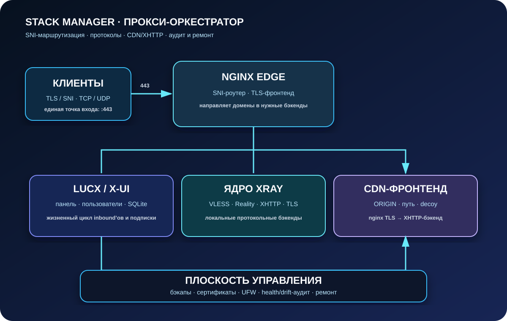

<p align="center">
  
</p>

<p align="center">
  <strong>Один сервер. Один порт 443. Полный контроль маршрутизации.</strong><br/>
  <sub>SNI-aware proxy orchestration for LucX/x-ui, Xray and nginx</sub>
</p>

<p align="center">
  <a href="#как-это-работает">Как работает</a> ·
  <a href="#возможности">Возможности</a> ·
  <a href="#установка">Установка</a> ·
  <a href="#диагностика">Диагностика</a> ·
  <a href="#безопасность">Безопасность</a>
</p>

# Stack Manager

### SNI-маршрутизация и управление прокси-стеком за одним портом 443

**LucX/x-ui · nginx SNI · Reality · XHTTP/CDN · Hysteria · AdGuard Home · decoy · fail2ban · UFW · Let's Encrypt**

[](https://www.gnu.org/software/bash/)
[](https://ubuntu.com/)
[](https://www.debian.org/)
[](LICENSE)

Один Bash-файл для установки, настройки, проверки, обслуживания и отката стека.

</div>

---

## Как это работает

Stack Manager — это управляющий слой над LucX/x-ui, Xray и nginx. Он не заменяет панель, а приводит связанные конфигурации к согласованному состоянию:

<p align="center">
  
</p>

Ключевой принцип: сначала проверка, затем изменение. Read-only-аудит не меняет сервер и показывает рассогласования между SQLite, nginx, SNI, CDN-профилями, decoy и сертификатами.

## Возможности

- **SNI-мультиплексирование** TCP-сервисов через единый внешний `443`.
- **VLESS Reality и TLS**, включая собственный SNI и HTTPS-decoy.
- **XHTTP без TLS через CDN** для поддерживаемых inbound’ов: CDN-домен, ORIGIN, path, hosts и nginx frontend.
- **XHTTP TLS** как отдельный режим без ошибочного предложения CDN.
- **Decoy-шаблоны** для доменов, Reality и TLS-маршрутов.
- **Сертификаты**: wildcard, персональные сертификаты, проверка домена, срока и пары сертификат/ключ.
- **Полный read-only health/drift-аудит** с обнаружением orphan CDN-профилей и неслушающих портов.
- **Управляемый DNS Xray**: системный DNS, Cloudflare/Google/Quad9 DoH, self-hosted DoH и пользовательский DoH.
- **Безопасное обслуживание**: backups, диагностика, UFW, fail2ban и «⚡ Проверить всё и починить» — один проход: read-only аудит → безопасная автопочинка найденного → контрольная проверка с дельтой «было → осталось».

## Что делает скрипт

`stack-manager.sh` объединяет сервисы на сервере и маршрутизирует TCP-соединения по SNI:

Маршрут трафика и компоненты подробно показаны на схеме выше. Stack Manager управляет не только входящими соединениями, но и связанными артефактами: SQLite, nginx, SNI-map, CDN-профилями, сертификатами и decoy.

По умолчанию наружу публикуются только необходимые порты. TCP-сервисы могут работать за `443`, а UDP-протоколы проверяются отдельно и не маскируются под TCP.

## Главное меню

```text
1) 🧭 Установка и маршрутизация
2) 🎭 Decoy и домены
3) 🔒 Сертификаты
4) 🛡️ Безопасность и firewall
5) 💾 Бэкапы и откат
6) 🩺 Диагностика и обслуживание
7) ⚙️ Панель и AdGuard
0) Выход
```

### Разделы

| Раздел | Назначение |
|---|---|
| **1. Установка и маршрутизация** | Первичная настройка, SNI, Reality, XHTTP/CDN, добавление и обслуживание инбаундов. |
| **2. Decoy и домены** | Смена заглушки, выбор шаблона, управление доменами и SNI-привязками. |
| **3. Сертификаты** | Let's Encrypt, wildcard Cloudflare DNS-01, персональные сертификаты, линии A/B, аудит и продление. |
| **4. Безопасность и firewall** | UFW, fail2ban, политики доступа, открытые порты и восстановление правил. |
| **5. Бэкапы и откат** | Ручные бэкапы, pre-install snapshot и полный откат. |
| **6. Диагностика и обслуживание** | Проверки сервисов, nginx, SNI, TCP/UDP-портов, сертификатов, состояния стека и «⚡ Проверить всё и починить». |
| **7. Панель и AdGuard** | LucX/x-ui, панельные пути, подписки и AdGuard Home. |

## Поддерживаемые инбаунды

Скрипт умеет создавать и настраивать следующие варианты:

```text
1) VLESS TCP Reality
2) VLESS TCP TLS (с HTTPS-decoy)
3) VLESS XHTTP TLS (HTTPS-decoy)
4) VLESS XHTTP Reality
4) NAIVE (TLS, за 443)
5) TRUSTTUNNEL (TLS, за 443)
6) ANYTLS (TLS, за 443)
7) HYSTERIA2 (UDP)
8) QWDTT (UDP 56000)
9) CSQTT (UDP 46000)
10) TG WEB-PROXY (443 → 11443)
```

TCP-инбаунды маршрутизируются через nginx по SNI и могут быть скрыты за единым внешним портом **443**. XHTTP без TLS внутри Xray может работать через CDN; XHTTP TLS работает с локальной HTTPS-заглушкой. Reality поддерживает выбор внешней цели или собственного SNI. UDP-инбаунды работают напрямую через UDP и проверяются отдельно правилами firewall.

## Reality: два режима

При настройке Reality скрипт предлагает выбрать режим:

### Внешняя цель

```text
1) Найти внешнюю цель
```

- выбирается домен из списка кандидатов;
- проверяется TLS 1.3 и HTTP/2;
- домен используется как `serverNames`/SNI и `dest`;
- сертификат на внешнюю цель не выпускается;
- локальный decoy не создаётся;
- TCP-инбаунд маршрутизируется за 443.

### Собственный SNI

```text
2) Указать свой SNI-домен
```

- используется собственный поддомен;
- выбирается или выпускается сертификат;
- создаётся HTTPS-decoy;
- домен добавляется в SNI-map nginx;
- сертификат и decoy можно сменить через раздел 2.

## XHTTP через CDN

CDN-режим предназначен для **VLESS XHTTP без TLS внутри Xray**. TLS завершается на nginx, поэтому схема выглядит так:

```text
клиент → CDN-домен:443 → CDN/прокси → ORIGIN-домен:443
       → nginx SNI → локальный TLS-фронтенд → Xray XHTTP (127.0.0.1:<порт>)
```

В пункте 1 для XHTTP задаётся вопрос:

```text
Это соединение будет работать через CDN?
```

Если ответить `да`, мастер создаёт единый CDN-профиль и согласует между собой:

- **CDN-домен** — публичное имя, указанное в клиенте и в `hosts` панели;
- **ORIGIN-домен** — имя сервера за CDN, с A/AAAA-записью на IP этого сервера;
- **XHTTP path** — одинаковый путь в клиенте, профиле и `xhttpSettings.path`;
- **origin SNI/Host** — ORIGIN-домен;
- **nginx SNI-маршрут** для ORIGIN и CDN-домена;
- **HTTPS-decoy** для ORIGIN на всех остальных путях.

### Сертификаты в CDN-схеме

Сертификат Let's Encrypt нужен **только для ORIGIN-домена**: его использует локальный nginx-фронтенд. Для CDN-домена сертификат Stack Manager не выпускает — TLS на публичной стороне завершает сам CDN.

Поэтому CDN-домен:

- не добавляется в SAN сертификата Stack Manager;
- не должен использоваться как домен для выпуска origin-сертификата;
- должен быть настроен у CDN-провайдера на ORIGIN;
- в `hosts` записывается как `address`, `sni` и `host_header`, с `security=tls`.

ORIGIN должен резолвиться на сервер **до выпуска сертификата**. Если DNS ещё не настроен, профиль может сохраниться, но nginx и сертификат не будут корректно подготовлены.

### Что должно совпадать

Для рабочего подключения одинаковыми должны быть значения:

```text
клиент:       address = CDN-домен, port = 443
XHTTP:        host = ORIGIN-домен, path = /ваш/путь
панель hosts: address/sni/host_header = CDN-домен, security = tls
nginx:        ORIGIN и CDN-домен → XHTTP path → локальный Xray-порт
```

В самом Xray CDN-инбаунд должен принимать обычный XHTTP без `security=tls` и без `security=reality`: шифрование до сервера выполняет nginx. Не добавляйте к такому инбаунду `externalProxy`, иначе трафик обойдёт созданный nginx-маршрут.

Профили сохраняются в `/root/stack-backups/cdn-profiles.tsv`. При удалении инбаунда его CDN-профиль, hosts-запись и связанные nginx-артефакты удаляются как устаревшие.

### Проверка и восстановление CDN

Через меню откройте `6) Диагностика и обслуживание`:

```text
7) Read-only аудит CDN и drift
8) Полный read-only аудит стека
```

Аудит проверяет базу панели, XHTTP host/path, `hosts`, SNI-map, nginx-блок, decoy, сертификат ORIGIN и реальные ответы локального фронтенда. Восстановление можно запустить из обслуживания: оно возвращает маршрут, `location ^~ <path>/` для XHTTP-сессий, hosts-запись и связанные настройки профиля.

Быстрые ручные проверки на сервере:

```bash
nginx -t
sed -n '1,220p' /etc/nginx/streams-enabled/sni-router.conf
grep -n -A45 -B2 '# >>> cdn' /etc/nginx/sites-enabled/stack.conf
cat /root/stack-backups/cdn-profiles.tsv
```

Если клиент получает HTML decoy или ошибку `unknown version: 60`, обычно сессионный запрос попал в заглушку вместо Xray. Проверьте, что nginx содержит `location ^~ <path>/`, а `path` клиента точно совпадает с профилем и `xhttpSettings.path`.

## Decoy

Поддерживаются шаблоны заглушек и пользовательский `index.html`.

Decoy применяется только там, где он не ломает протокол:

- собственный Reality;
- панель;
- TCP HTTPS-часть Hysteria/Hysteria2;
- отдельные поддерживаемые TCP-маршруты.

Для следующих протоколов decoy не назначается:

- внешний Reality;
- AnyTLS;
- naive/trust-tunnel, если TLS терминирует sidecar;
- TG WEB-PROXY;
- UDP-транспорт без отдельного TCP-входа.

Если корень домена панели используется AdGuard Home, смена корневого decoy блокируется, чтобы не повредить UI и DoH.

## DNS Xray и DoH

Настройка DNS Xray находится в разделе меню:

```text
7) Панель и AdGuard → DNS Xray
```

Поддерживаются системный DNS, Cloudflare DoH, Google DoH, Quad9 DoH,
self-hosted DoH панели и пользовательский DoH. Для self-hosted-профиля
скрипт автоматически определяет домен панели и IPv4-адрес сервера.

Профили **5 и 6 проверяются обязательно**. Одной проверки регулярным
выражением недостаточно: перед изменением панели скрипт дополнительно
проверяет диапазоны IPv4, корректность hostname, совпадение host с URL и
делает реальный DNS-over-HTTPS запрос к `example.com`. Проверяются HTTP 200,
DNS-флаг ответа, `RCODE=0` и наличие ответа. Если пользователь ввёл
несуществующий или недоступный endpoint, Xray не изменяется, а `x-ui` даже
не останавливается.

Настройки применяются к глобальному шаблону Xray панели:

```text
/etc/x-ui/x-ui.db
└── settings
    └── xrayTemplateConfig
```

Если `xrayTemplateConfig` ещё отсутствует, Stack Manager безопасно создаёт
его из текущего рабочего конфига `/usr/local/x-ui/bin/config.json`, только
после проверки обязательных outbound `direct` и `blocked` и существующих
`routing.rules`. Перед изменением базы создаётся backup. При ошибке записи,
перезапуска панели или потере DNS после генерации конфигурация автоматически
откатывается.

После применения можно проверить результат:

```bash
sqlite3 -noheader /etc/x-ui/x-ui.db \
  "SELECT value FROM settings WHERE key='xrayTemplateConfig';" | \
  jq '{dns: .dns, domainStrategy: .routing.domainStrategy}'

jq '{dns: .dns, domainStrategy: .routing.domainStrategy}' \
  /usr/local/x-ui/bin/config.json
```

При отсутствии шаблона и рабочего `config.json` операция отменяется без
изменения базы. Stack Manager не создаёт минимальный или неполный Xray-конфиг.

## Установка

Требования:

- Ubuntu 22.04+ или Debian 11+;
- root-доступ;
- домен с DNS-записью на сервер;
- открытые SSH и 443;
- для wildcard Cloudflare — API Token с правом `Zone:DNS:Edit`.

### Скачать и запустить

> **Важно для Linux:** GitHub/raw-прокси иногда возвращает файл с Windows-окончаниями строк `CRLF`. Перед запуском обязательно удалить символы `\r`, иначе Bash покажет `invalid option name` и `syntax error near $'{\\r''`.

```bash
curl -4 -fsSL \
  "https://raw.githubusercontent.com/vladufqaa/stack-manager/main/stack-manager.sh?ts=$(date +%s%N)-$$" \
  -o /root/stack-manager.sh
sed -i 's/\r$//' /root/stack-manager.sh
chmod 700 /root/stack-manager.sh
bash -n /root/stack-manager.sh
bash /root/stack-manager.sh
```

Или одной командой:

```bash
curl -4 -fsSL "https://raw.githubusercontent.com/vladufqaa/stack-manager/main/stack-manager.sh?ts=$(date +%s%N)-$$" \
  | tr -d '\r' > /root/stack-manager.sh && chmod 700 /root/stack-manager.sh && \
  bash -n /root/stack-manager.sh && bash /root/stack-manager.sh
```

Проверить окончания строк можно так:

```bash
file /root/stack-manager.sh
# в выводе не должно быть: CRLF line terminators
grep -U $'\r' /root/stack-manager.sh
# команда выше не должна вывести строк

Пункт 1 работает в два этапа: сначала собираются параметры и показывается план, затем изменения применяются только после подтверждения.

## Диагностика

Через меню:

```text
6) Диагностика и обслуживание
├─ 7) Read-only аудит CDN и drift
└─ 8) Полный read-only аудит стека
```

Полный аудит проверяет inbound’ы, hosts, SNI/nginx, CDN, decoy, сертификаты, systemd и реальные listening sockets. Он ничего не исправляет автоматически.

Для ручной проверки:

```bash
bash /root/stack-manager.sh --check
bash /root/stack-manager.sh --self-test
nginx -t
ss -ltnup
```

## Безопасность

- Перед изменениями сохраняйте backup конфигурации.
- Не запускайте непроверенный скрипт через `curl | bash`.
- После загрузки нормализуйте CRLF и выполняйте `bash -n`.
- CDN-аудит read-only: найденный drift сначала показывается, а не удаляется молча.
- Для production используйте отдельный ORIGIN-домен и корректный сертификат.

## Проверка без меню

```bash
bash /root/stack-manager.sh --check
bash /root/stack-manager.sh --self-test
```

Проверка nginx:

```bash
nginx -t
```

Проверка SNI-конфига:

```bash
sed -n '1,160p' /etc/nginx/streams-enabled/sni-router.conf
```

Проверка побайтного совпадения с GitHub:

```bash
curl -4 -fsSL \
  "https://raw.githubusercontent.com/vladufqaa/stack-manager/main/stack-manager.sh?ts=$(date +%s)" \
  -o /tmp/stack-manager.remote.sh
cmp -s /root/stack-manager.sh /tmp/stack-manager.remote.sh && echo 'Файлы совпадают'
```

## Бэкапы и откат

Перед изменениями скрипт создаёт автоматические бэкапы и pre-install snapshot.

Полный откат восстанавливает `x-ui.db` целиком к состоянию pre-install snapshot. Это возвращает Reality, CDN/XHTTP, hosts, SNI-поля, настройки панели и клиентов к моменту снимка.

> **Важно:** полный откат удаляет из текущей базы изменения, сделанные после создания snapshot, включая новые инбаунды, клиентов и настройки панели. Перед заменой базы создаётся аварийная копия текущего `x-ui.db`.

Не удаляются автоматически:

- AdGuard Home;
- сертификаты Let's Encrypt в `/etc/letsencrypt/live/`.

Если pre-install snapshot отсутствует, используется выборочное восстановление доступных настроек.

## Безопасность и сохранность данных

- пользовательские сертификаты и `/root/cert` не удаляются при обычном обслуживании;
- инбаунды и клиенты не заменяются при выборочном откате;
- автоматические изменения журналируются в `/root/stack-actions.log`;
- SQL-правки выполняются с остановкой панели, когда это необходимо;
- SNI-map проверяется перед добавлением новых маршрутов;
- UDP-инбаунды сверяются с правилами UFW;
- `q` в вопросе возвращает в меню.

## Расположение файлов

| Путь | Назначение |
|---|---|
| `/root/stack-manager.sh` | Основной скрипт |
| `/etc/x-ui/x-ui.db` | База LucX/x-ui |
| `/etc/nginx/streams-enabled/sni-router.conf` | SNI-map и stream-маршрутизация |
| `/etc/nginx/sites-enabled/stack.conf` | HTTP/HTTPS-конфигурация панели и decoy |
| `/var/www/decoy-templates/` | Шаблоны заглушек |
| `/root/stack-backups/` | Автоматические и pre-install бэкапы |
| `/root/stack-actions.log` | Журнал действий |

## Устранение типовых проблем

### `Too many levels of symbolic links`

Удалите старую циклическую ссылку и повторите запуск обновлённого скрипта:

```bash
rm -f /etc/nginx/streams-enabled/sni-router.conf
rm -f /etc/nginx/streams-available/sni-router.conf
nginx -t
```

Скрипт создаст SNI-конфиг заново как обычный файл.

### `invalid number of the map parameters`

Проверьте SNI-map:

```bash
sed -n '1,160p' /etc/nginx/streams-enabled/sni-router.conf
```

Строки внутри `map` должны содержать ровно два значения и `;`:

```nginx
domain.example.com    inb_4_backend;
```

Обновлённый скрипт очищает повреждённые строки перед добавлением нового маршрута.

### ORIGIN не проходит проверку DNS

Добавьте A/AAAA-запись ORIGIN-домена на IP сервера и дождитесь обновления DNS:

```bash
getent ahosts origin.example.com
```

После этого повторите выпуск сертификата в разделе 3.

## Благодарности и ссылки

Проект использует и интегрируется с открытыми проектами:

- [LucX UI](https://github.com/AlexeyLCP/lucx-ui) — панель управления прокси-инбаундами;
- [3x-ui](https://github.com/MHSanaei/3x-ui) — основа панели и базы конфигурации;
- [AdGuard Home](https://github.com/AdguardTeam/AdGuardHome) — DNS-фильтрация и DoH;
- [nginx](https://nginx.org/) — HTTP- и SNI-маршрутизация;
- [Certbot](https://certbot.eff.org/) — выпуск и продление сертификатов;
- [fail2ban](https://github.com/fail2ban/fail2ban) — защита от перебора и автоматические блокировки;
- [UFW](https://launchpad.net/ufw) — управление правилами firewall.

Отдельная благодарность [Mannokia](https://github.com/Mannokia) за идеи и доработки, связанные с линиями сертификатов A/B, wildcard-выпуском через Cloudflare DNS-01, аудитом сертификатов, очисткой дублей и TUI-управлением firewall.

## Лицензия

MIT. Используйте программное обеспечение в соответствии с законодательством вашей юрисдикции.
